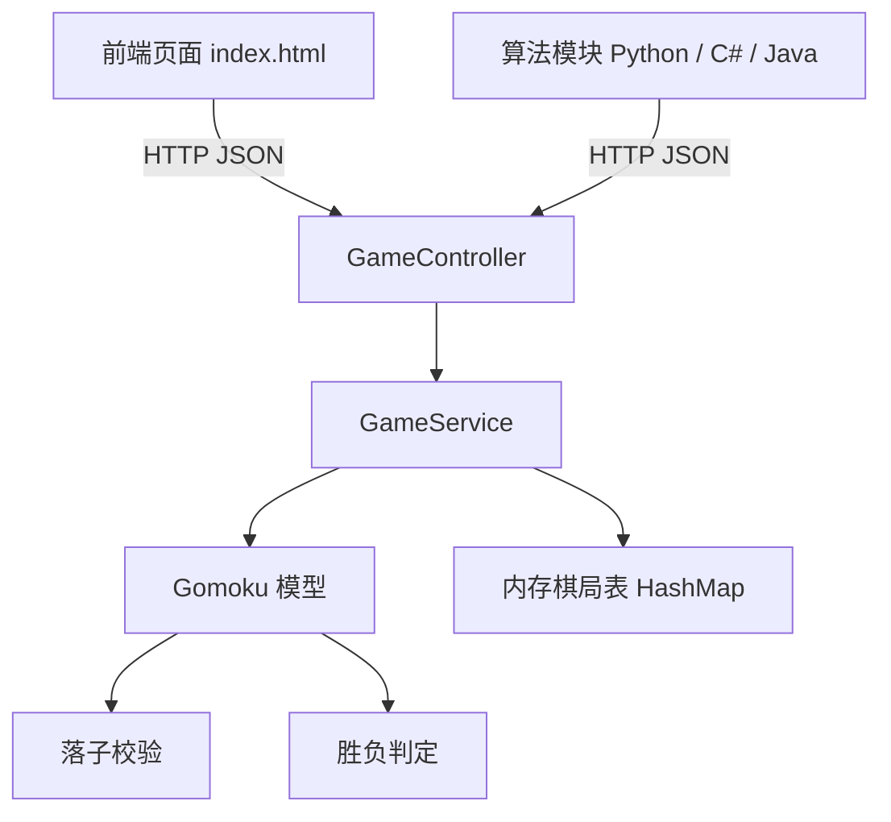

# 五子棋最优策略

9×9 五子棋最优策略研究项目。系统由三部分组成：Java Spring Boot 实现的棋局后端、原生 HTML/CSS/JavaScript 前端，以及五种不同思路的 AI 算法模块。

## 1. 项目简介

项目目标是给出一个可复用的五子棋最优落子策略，并对比不同技术路线在同一套接口下的表现。

- 棋盘固定为 9×9，黑棋先行，横、竖、斜任一方向连成五子获胜，下满棋盘为平局。
- 后端以 HTTP 接口管理棋局，算法与前端只依赖该接口，互不耦合。
- 算法侧不做技术栈限制，Python、C#、Java、PyTorch 均有实现，便于横向对比。

## 2. 仓库结构

```text
gobang/
├── BestStrategyOfGomoku/Gomoku/   后端与前端（Spring Boot + 静态页面）
│   └── src/main/
│       ├── java/com/gomoku/      GameController / GameService / Gomoku / GomokuRequest
│       └── resources/
│           ├── application.properties
│           └── static/           index.html / style.css / gomoku.js
├── CurrentToWin/                 现在到必胜算法（Python）
├── WinToCurrent/                 必胜局面逆推算法（Java）
├── Heuristics/                   启发式算法（C#）
├── DeepLearning/                 深度学习算法（PyTorch）
├── AI/                           大模型 API 方案（Python）
├── 算法文档.md                    算法原理、实现与对比
└── 实践报告.md                    项目过程、分工与总结
```

## 3. 系统架构

前端与算法模块都通过 REST 接口操作同一份棋局数据，后端用内存容器保存棋局。



## 4. 快速开始

### 4.1 启动后端

需要 JDK 17。构建产物为 `build/libs/Gomoku-0.0.1-SNAPSHOT.jar`，服务端口 `10086`。

```powershell
cd BestStrategyOfGomoku\Gomoku
$env:JAVA_HOME="D:\JDK17"
.\gradlew.bat build -x test
D:\JDK17\bin\java.exe -jar build\libs\Gomoku-0.0.1-SNAPSHOT.jar
```

### 4.2 打开前端

浏览器访问 `http://localhost:10086`。页面打开后会自动加载当前游戏 ID 的棋盘：

- 棋盘已存在：直接点击交叉点落子。
- 棋盘不存在：在页面左侧填好游戏 ID 与棋盘大小，点击「创建游戏」。

### 4.3 人机对战

网页负责落子，算法模块负责应棋。两个程序通过同一份棋局数据协作，因此游戏 ID 必须一致。

```powershell
cd CurrentToWin
python Web_main.py
# 依次输入：API 地址 http://localhost:10086/api、游戏 ID、菜单项 5（自动对弈）、执棋颜色 -1（白棋）
```

### 4.4 各算法模块启动方式

| 模块 | 语言 | 启动命令 |
| --- | --- | --- |
| 现在到必胜（静态） | Python | `python main.py` |
| 现在到必胜（动态） | Python | `python Web_main.py` |
| 必胜局面逆推 | Java | `java com.gomoku.GomokuAiRunner <游戏ID> <black/white>` |
| 启发式 | C# | `dotnet build` 后运行 `bin/Debug/net8.0/启发式.exe` |
| 深度学习 | Python | `python main.py --play`，或 `python main.py --train` |
| 大模型 API | Python | `python Ai.py`（需先配置 `config.json`） |

## 5. 接口说明

所有接口均返回 JSON，`code` 为 0 表示成功，非 0 表示失败并附带原因。

| 方法 | 路径 | 作用 |
| --- | --- | --- |
| POST | `/api/gomoku` | 创建棋局 |
| GET | `/api/gomoku/{id}` | 查询棋局，附加 `?showStatus=true` 返回回合与结果 |
| PUT | `/api/gomoku/{id}` | 落子或导入新棋盘 |
| DELETE | `/api/gomoku/{id}` | 删除棋局 |

### 5.1 创建棋局

```http
POST http://localhost:10086/api/gomoku
Content-Type: application/json
```

```json
{
  "id": 1,
  "x": 9,
  "y": 9
}
```

响应：

```json
{
  "code": 0,
  "msg": "棋盘创建成功"
}
```

### 5.2 查询棋局

```http
GET http://localhost:10086/api/gomoku/1?showStatus=true
```

```json
{
  "code": 0,
  "board": [[0, 0, 0, 0, 0, 0, 0, 0, 0]],
  "nextPlayer": 1,
  "isGameOver": false,
  "winner": 0
}
```

`showStatus=false` 时只返回 `board`。

| 字段 | 取值 | 含义 |
| --- | --- | --- |
| nextPlayer | 1 / -1 | 1 轮到黑棋，-1 轮到白棋 |
| isGameOver | true / false | 棋局是否结束 |
| winner | 1 / -1 / 2 | 黑棋胜 / 白棋胜 / 平局，未结束时为 0 |

### 5.3 落子

可以传坐标，也可以直接传整块棋盘。

```json
{
  "x": 0,
  "y": 1,
  "player": 1
}
```

```json
{
  "board": [
    [0, -1, 0, 0, 0, 0, 0, 0, 0],
    [0, 0, 1, 0, 0, 0, 0, 0, 0]
  ]
}
```

### 5.4 删除棋局

```http
DELETE http://localhost:10086/api/gomoku/1
```

## 6. 棋盘数据格式

棋盘统一用二维整型数组表示，`0` 为空位，`1` 为黑棋，`-1` 为白棋。

```json
{
  "board": [
    [0, 0, 0, 0, 0],
    [0, 0, 1, 0, 0],
    [0, 0, -1, 1, 0],
    [0, 0, -1, 0, 1],
    [0, 0, 0, 0, 0]
  ],
  "current_player": 1
}
```

数组下标即棋盘坐标，行列均从 0 开始；部分模块额外使用从 1 开始的“数学坐标”，转换在模块内部完成。

## 7. 算法方案速览

| 方案 | 语言 | 核心思路 | 状态 |
| --- | --- | --- | --- |
| 启发式 | C# | 棋形评分，选最高分空位 | 可用，防守稳定 |
| 现在到必胜 | Python | 21 种阵法库匹配 + 威胁扫描 | 可用，响应快 |
| 必胜局面逆推 | Java | 棋型匹配 + 2 步深度搜索 | 可用，攻防兼顾 |
| 深度学习 | PyTorch | AlphaZero 结构 + MCTS + 自对弈 | 未达预期，已终止 |
| 大模型 API | Python | 提示词 + 棋局 JSON 直接求解 | 未达预期，已终止 |

各方案的原理、实现细节与实验结果见 [算法文档](算法文档.md)。

## 8. 文档索引

| 文档 | 内容 |
| --- | --- |
| [算法文档.md](算法文档.md) | 五种算法的原理、数据结构、运行流程与结论 |
| [实践报告.md](实践报告.md) | 项目背景、分工、系统设计、协作规范与总结 |

## 9. 环境与依赖

| 依赖 | 版本要求 | 用途 |
| --- | --- | --- |
| JDK | 17 | 后端编译与运行 |
| Gradle | 随 wrapper | 后端构建 |
| Python | 3.8+ | 算法模块 |
| .NET | 8.0 | C# 启发式模块 |
| org.json | 20240303 | Java 逆推模块 |

Python 模块依赖：

```bash
pip install -r DeepLearning/requirements.txt
```
