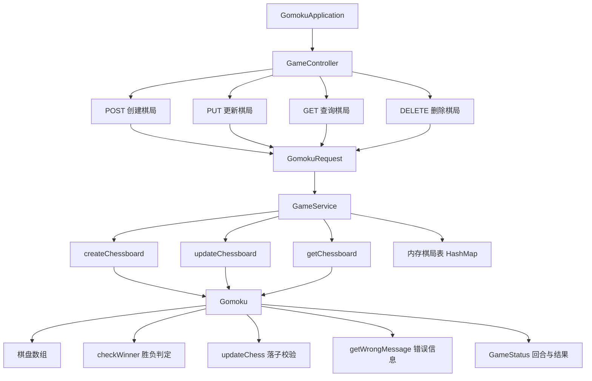
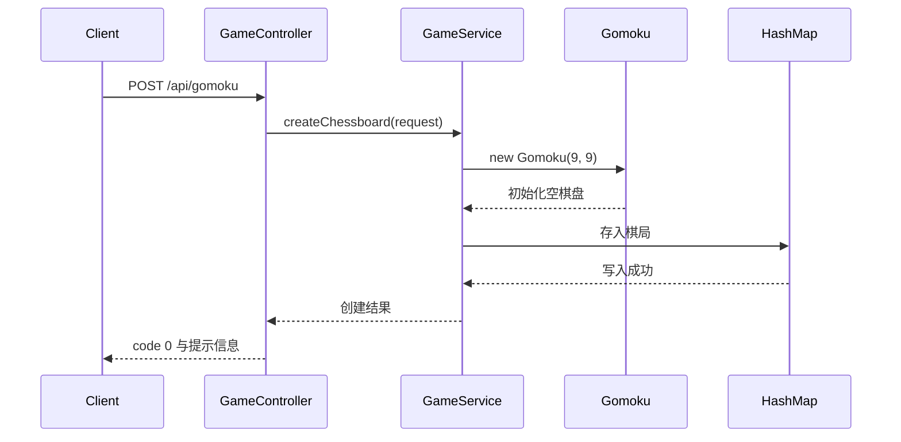
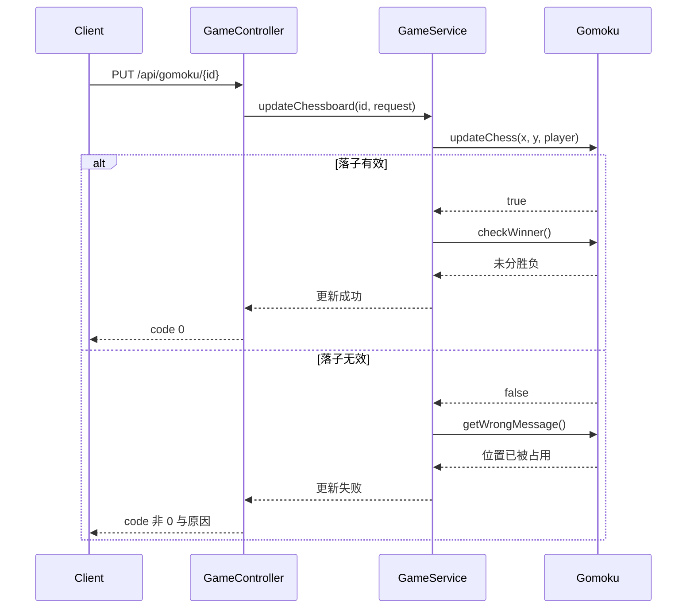
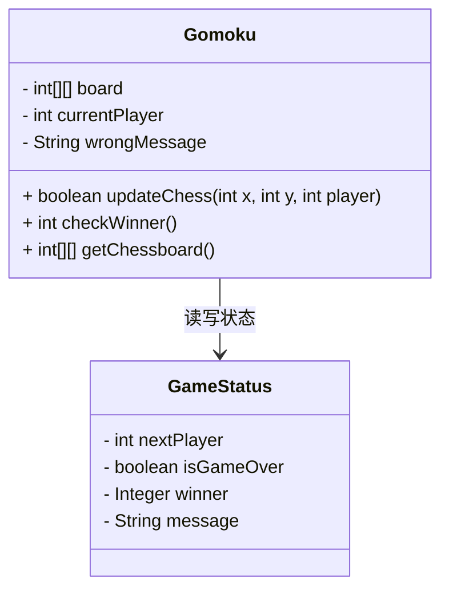
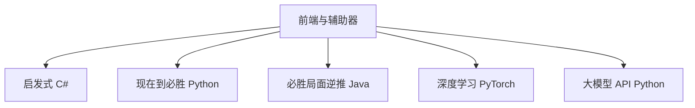
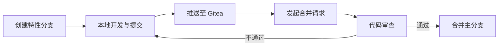

# 实践报告

## 1. 项目背景

小组选题为“游戏的最优策略”，具体对象是 9×9 五子棋。项目目标是实现一个可复用的最优落子策略，而不是只做一个能下棋的玩具。

立项时的基本设想有三点：

1. 先实现五子棋本体，用 `n×n` 数组表示棋盘，JSON 作为输入输出格式，便于算法遍历与可视化。
2. 算法部分不从网上照搬答案，而是自己借助工具推导与验证。
3. 每个成员边做边写文档，记录做了什么、为什么这么做、怎么做的。

技术栈不设限制，游戏本体采用前端三件套加 Java Spring Boot，算法部分横跨 Python、PyTorch、C#、Java。版本控制使用组长部署的 Gitea 加 Git，设计三条分支，对标企业级代码工作流，并要求文档驱动式开发。

## 2. 人员与分工

### 2.1 人员组成

| 角色 | 成员 |
| --- | --- |
| 组长 | 黄应辉 |
| 组员 | 冯思语、郑逸驰、罗展彬、易雨杰、李金旺 |

### 2.2 分工

| 成员 | 负责内容 |
| --- | --- |
| 罗展彬 | 前端 JavaScript 脚本，后端游戏控制器类、游戏请求类、游戏服务类 |
| 易雨杰 | 前端主页面与样式，后端五子棋模型类 |
| 黄应辉 | 把控项目方向与落地进度，探索深度学习方案 |
| 冯思语 | 探索从当前局面推算到特定必胜局面的算法 |
| 郑逸驰 | 探索启发式算法 |
| 李金旺 | 探索从必胜局面逆推当前局面的算法 |

## 3. 游戏规则

- 棋盘默认 9×9，双方轮流落子。
- 黑棋先行，只能落在交点处的空位。
- 横、竖、斜任一方向连成五子即获胜；棋盘下满且无人获胜为平局。

## 4. 系统设计

### 4.1 后端架构

后端由 Spring Boot 提供 REST 接口，服务层持有内存棋局表，模型层负责落子校验与胜负判定。

### 4.2 创建棋局时序

### 4.3 落子时序

### 4.4 关键数据结构

### 4.5 接口设计

接口定义与请求响应示例见 [README 的接口说明](README.md#5-接口说明)，此处不再重复。设计要点如下：

- 创建与更新分开，创建使用 POST，落子使用 PUT，语义清晰。
- 查询接口默认只返回棋盘，附加 `showStatus=true` 才返回回合与胜负状态，减少无关数据传输。
- 统一返回 `code` 与 `msg`，失败原因由模型层生成，前端直接展示。

### 4.6 前端设计

- 棋盘渲染：HTML/CSS 绘制网格，JavaScript 动态生成棋子，适配不同屏幕宽度。
- 落子交互：点击交叉点触发 PUT 请求。
- 状态管理：通过定时刷新获取最新棋盘，依据 `isGameOver` 与 `winner` 展示结果。
- 容错处理：位置被占用、非法操作等错误直接提示在页面上。

## 5. 算法路线

项目并行探索了五条路线，详细原理见 [算法文档](算法文档.md)。

| 方案 | 结论 |
| --- | --- |
| 启发式 | 稳定、响应快，防守可靠，进攻性偏弱 |
| 现在到必胜 | 阵法库驱动，响应低于 100ms，可解释性强 |
| 必胜局面逆推 | 棋型匹配加有限搜索，攻防兼顾 |
| 深度学习 | 训练不稳定，对战传统算法胜率仅 13%，终止 |
| 大模型 API | 落子集中且会覆盖已有棋子，终止 |

### 5.1 暴力算法的排除

穷举全部胜局需要约 $5.8 \times 10^{120}$ 个棋盘，折合存储量约 $1.56 \times 10^{99}$ YB，不具备可行性。这一估算直接决定了后续方案都走近似路线。

## 6. 项目管理与协作

### 6.1 Git 工作流

协作约定：

1. 每个功能单独开分支，不直接改动主分支。
2. 提交前先同步主分支，减少冲突。
3. 合并必须经过代码审查。
4. 使用自建 Gitea 平台，模拟企业内部的代码托管与审计流程。

### 6.2 文档驱动

- 所有文档统一使用 Markdown，便于版本控制与差异对比。
- 文档结构要求体现“想怎么做、为什么这么做、如何做”，不接受机械生成的文稿。
- 接口文档必须包含请求与响应示例，算法文档必须说明核心逻辑。

## 7. 项目成果

项目周期为 2025.6.23 至 2025.7.8，共 15 天。

| 类别 | 成果 |
| --- | --- |
| 系统 | 完整前后端，支持 9×9 对弈与多算法接入 |
| 算法 | 探索 5 种方案，其中 3 种达到可用水平 |
| 协作 | 6 人团队，累计提交 85 次，文档 3 万字以上 |

在线体验地址为 gomoku.handywote.site，由团队自行部署。

核心创新点在于用统一的 REST 接口把算法与界面解耦，使五种技术路线可以并行开发、随时切换，并能直接互相对弈比较。

## 8. 经验与教训

### 8.1 有效做法

1. 接口先行。先定好 JSON 格式与 HTTP 语义，前后端与各算法模块才能真正并行。
2. 模块化。每个算法独立成目录、独立入口，互不依赖。
3. 文档同步。边做边写，降低了后期整合成本。

### 8.2 主要教训

1. 算力评估要在立项阶段完成。深度学习方案启动后才意识到训练成本远超预期。
2. 提示词方案不适合精确决策。大模型难以稳定控制落子位置，验证机制成本高。
3. 有限模式库的上限明显。特殊棋形与长线规划仍是启发式与阵法方案的短板。

### 8.3 后续可改进方向

1. 在现有阵法库基础上补充更复杂的攻防组合，并引入简单的局面评估函数。
2. 用可用算法作为基线，为神经网络提供稳定的对手与评估标准。
3. 将棋局存储从内存迁移到持久化存储，支持复盘与数据积累。
