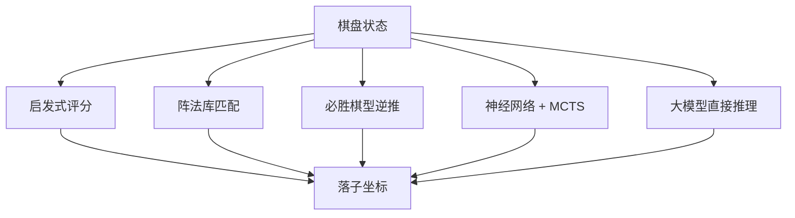
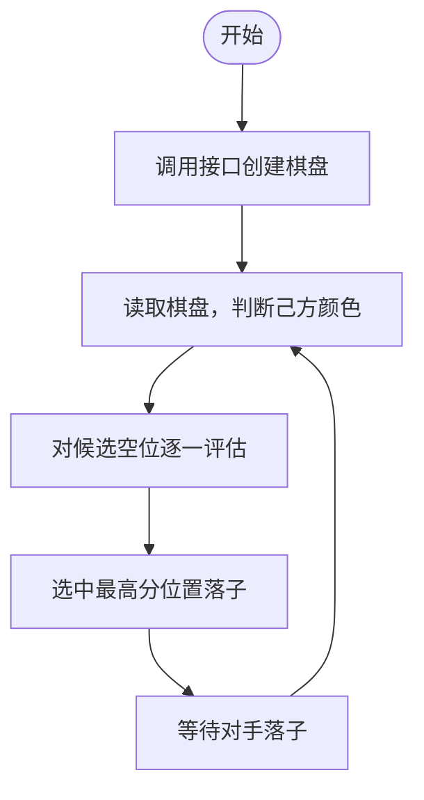
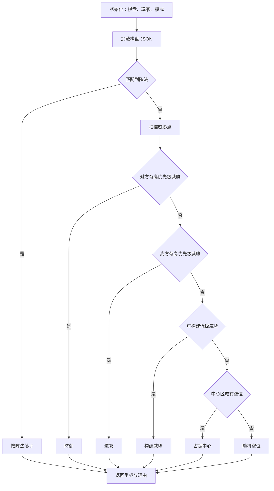
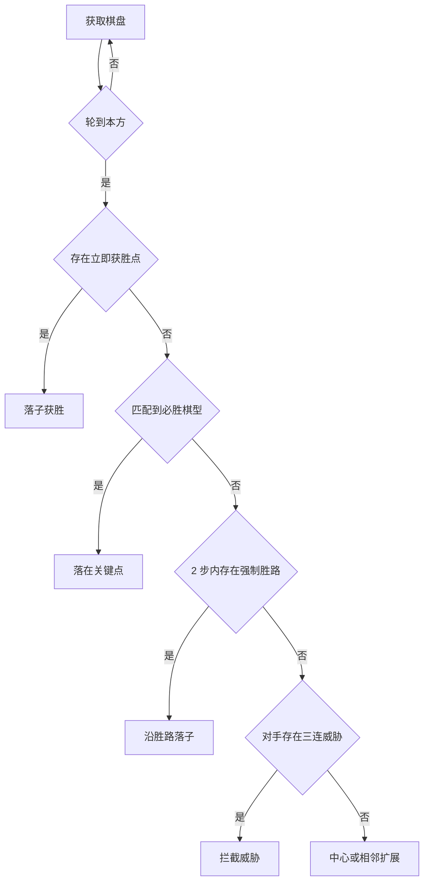
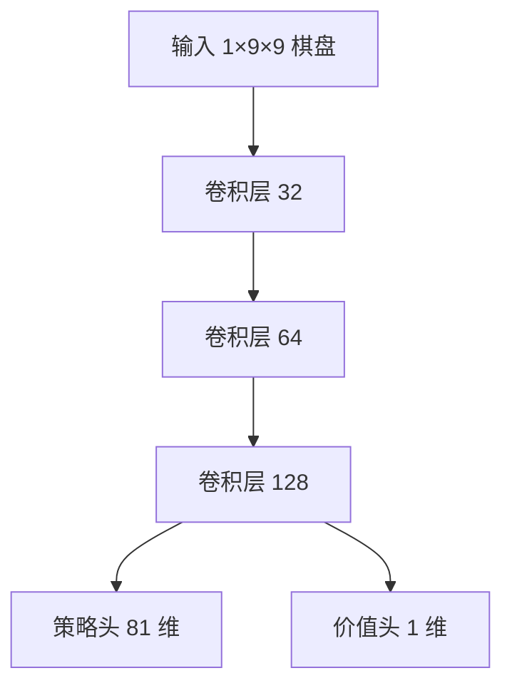
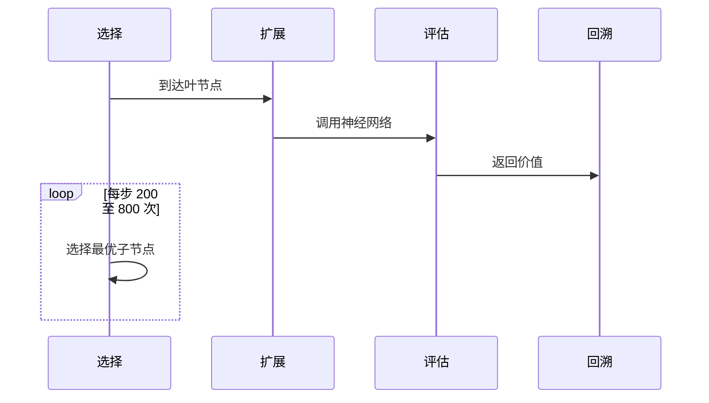
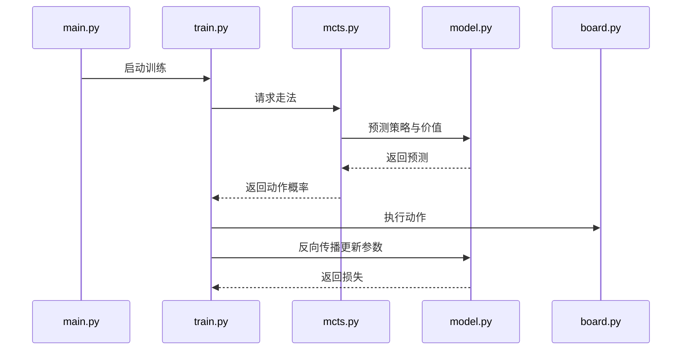
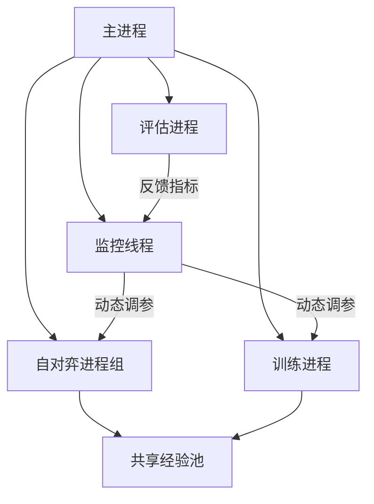

# 五子棋算法文档

本文汇总项目中五种算法方案的原理、数据结构、运行流程与实验结果。所有算法共用同一套棋盘 JSON 与 HTTP 接口，因此可以直接横向对比。

## 1. 方案概览

五子棋是完全信息、确定性的零和博弈，任何一方都能看到完整棋盘，因此理论上存在一个最优策略函数：给定棋盘状态即给出最佳落子。难点在于状态空间过大，五种方案分别从不同角度做了近似。



| 方案 | 语言 | 决策依据 | 计算量 | 状态 |
| --- | --- | --- | --- | --- |
| 启发式 | C# | 棋形评分累加 | 局部遍历 | 可用 |
| 现在到必胜 | Python | 预定义阵法 | 模式匹配 | 可用 |
| 必胜局面逆推 | Java | 棋型匹配 + 有限搜索 | 深度 2 | 可用 |
| 深度学习 | PyTorch | 策略与价值网络 | 训练开销大 | 已终止 |
| 大模型 API | Python | 提示词推理 | 单次请求 | 已终止 |

## 2. 暴力搜索的可行性

棋类问题最直接的想法是遍历全部棋路或穷举全部胜局，但两种做法都不可行。

先在 9×9 棋盘上估算穷举全部落子顺序的存储量：

- 全部落子顺序数约为 $81! \approx 5.8 \times 10^{120}$。
- 一个 `int[9][9]` 棋盘占 $324$ 字节。
- 总存储量为 $324 \times 5.8 \times 10^{120} \approx 1.56 \times 10^{99}$ YB。

这一量级远超任何可用硬件，因此项目转向了启发式、模式匹配与神经网络等近似方法。

## 3. 启发式算法（C#）

### 3.1 设计

启发式方案的核心是把局面好坏量化成分数：对每个候选空位模拟落子，扫描该点四个方向共 32 个位置，识别形成的棋形并按分数累加，最后选择总分最高的位置。

四个类对应四个职责：

| 类 | 职责 |
| --- | --- |
| `JsonWenJian` | 读取 JSON 棋盘并转换为二维数组 |
| `EvaluateTime` | 核心评估函数，负责评分与遍历 |
| `Test` | 程序入口，串联读取、评估、落子 |
| `KeHuDuan` | 与网页接口交互，发送落子请求 |

### 3.2 评分标准

不同棋形赋予差异极大的分值，保证高价值棋形拥有绝对优先级，不会被多个低价值棋形误导。

| 棋形 | 分数 |
| --- | --- |
| 双通二连 | 8 |
| 单通二连 | 2 |
| 双通三连 | 100 |
| 单通三连 | 10 |
| 双通四连 | 10000 |
| 单通四连 | 100 |
| 双通五连 | 100000 |

“双通”指两端均为空位，“单通”指一端被对方棋子堵死。

### 3.3 运行流程



### 3.4 评价

- 优点：逻辑简单、运行稳定、响应快，基本不会出现致命失误。
- 缺点：偏防守，进攻性弱；复杂棋形与特殊局面识别能力有限。

## 4. 现在到必胜算法（Python）

### 4.1 阵法库

方案把网络上常见的五子棋“必胜阵法”整理成有限模式库，黑棋 13 个、白棋 8 个，共 21 个，存放在 `WinningPart.py`。

由于阵法中各方棋子数不超过 3，本身不构成真正的必胜局面，因此 `WinStrategy.py` 会优先做阵法匹配，匹配不上再进入威胁分析。

存储按棋子数量分类：

| 阵法 | 数组元素和 | 分类方式 |
| --- | --- | --- |
| 黑棋阵法 | 0 | 0 黑 0 白、1 黑 1 白、2 黑 2 白 |
| 白棋阵法 | 1 | 1 黑 0 白、2 黑 1 白、3 黑 2 白 |

### 4.2 决策流程

决策按优先级自高到低依次尝试，命中即返回，并附带落子理由。



### 4.3 关键实现

- 阵法匹配支持四个方向的旋转与镜像对称。
- 威胁检测按级别划分：活三、眠三、活二等，并给出对应优先级。
- 坐标系统在数组坐标与数学坐标之间转换，接口与算法各自使用习惯坐标。

### 4.4 两个入口

| 入口 | 用途 |
| --- | --- |
| `main.py` | 静态测试。读取文件或粘贴 JSON，输出一次落子决策，可选弹窗展示 |
| `Web_main.py` | 动态对弈。通过 `GomokuClient.py` 对接网页接口，支持创建棋局、查看棋盘、自动落子、自动对弈 |

### 4.5 评价

- 优点：响应时间低于 100ms，内存占用低于 10MB，决策有明确理由，可解释性强。
- 缺点：阵法库覆盖有限，开局策略偏固定，长线规划能力不足。

## 5. 必胜局面逆推（Java）

### 5.1 模块划分

| 类 | 职责 |
| --- | --- |
| `GomokuAiRunner` | 启动入口，按参数配置棋盘 ID 与执棋颜色 |
| `GomokuAiClient` | 轮询服务器获取棋盘，提交落子 |
| `GomokuWinningAnalyzer` | 核心分析器，负责模式匹配与搜索 |

### 5.2 决策优先级



### 5.3 关键方法

- `isWinningMove`：沿横、竖、两条对角线统计同色连子，达到 5 即判胜。
- `matchesPattern`：用预定义的必胜棋型与威胁棋型扫描棋盘，如活三模式 `[0,1,1,1,0]` 命中后推荐两端落子。
- `findForcedWinPaths`：模拟落子后递归检查两步内能否形成必胜，深度限制为 2 以避免计算爆炸。

### 5.4 评价

- 优点：必胜局面识别准确，攻防兼顾，响应时间约 150ms。
- 缺点：深度限制削弱长线策略，特殊棋形识别不足，开局较固定。

## 6. 深度学习（PyTorch）

### 6.1 原理

方案采用 AlphaZero 思路，由三个部分组成：

1. 神经网络同时输出策略（往哪走）与价值（局面好坏）。
2. 蒙特卡洛树搜索结合网络预测，把算力集中到最有希望的分支。
3. 自对弈强化学习，用当前模型生成数据，再用数据提升模型。



策略头输出 81 个落子概率，价值头经 tanh 输出 [-1, 1] 的胜率预测。

### 6.2 MCTS 流程



主要参数：`c_puct = 1.5`，模拟次数训练阶段 800、实际实现默认 200，温度训练时 1.0、对战时 0.1。

### 6.3 训练

每轮迭代包含自对弈与训练两步，损失由策略交叉熵与价值均方误差加权求和。

| 参数 | 默认值 | 说明 |
| --- | --- | --- |
| 学习率 | 0.001 | Adam 初始学习率 |
| batch size | 256 | 每次训练样本数 |
| 自对弈局数 | 30 | 每轮生成棋局数 |
| 训练步数 | 300 | 每轮梯度更新步数 |
| MCTS 模拟次数 | 200 | 每步搜索模拟次数 |
| 经验池容量 | 50000 | 经验回放上限 |
| 多进程数 | 4 | 自对弈并行进程数 |

模型权重保存为 `.pth` 文件，训练中途每 50 轮保存一次中间模型，结束时保存最终模型。



### 6.4 AMD 显卡支持

项目通过 `torch_directml` 在 AMD 显卡上运行训练：

- `model.py` 与 `train.py` 初始化时检测并选择 DirectML 设备。
- 依赖中加入 `torch_directml>=1.0.0`。
- 启动后控制台会输出设备名，任务管理器中可观察到显卡占用。

### 6.5 7.4 版本改进

7.4 版本针对训练效率做了三项调整：



| 调整维度 | 触发条件 | 策略 |
| --- | --- | --- |
| 自对弈进程数 | 经验池利用率低于 50% 或高于 90% | 增减 CPU 核心数 1 至 2 倍的进程 |
| batch size | 显存变化 | 在 64 至 512 之间调整 |
| 训练强度 | 损失大于 1.0 或胜率高于 80% | 增减自对弈局数 |

相对 6.29 版本，训练速度由每小时 120 局提升到 180 局，GPU 利用率由 60% 至 70% 提升到 85% 至 95%，OOM 问题消失。

### 6.6 终止说明

方案最终终止，原因有三：

1. 时间不足。完整训练与参数调优周期超出项目排期。
2. 训练不稳定。损失收敛趋势不平稳，长期训练后出现震荡。
3. 实际效果不佳。使用 2×2080Ti 训练后，对战传统 Minimax 算法胜率仅 13%。

结论是深度学习方案对算力要求极高，需要长期稳定的训练与精细调参；在资源受限的项目周期内，传统算法更具优势。

## 7. 大模型 API 方案（Python）

### 7.1 原理

直接把棋盘 JSON 与提示词发给大语言模型，要求模型返回落子坐标，不依赖本地训练。

请求体示例：

```json
{
  "board": [
    [0, 0, 0, 0, 0, 0, 0, 0, 0],
    [0, 0, 0, 0, 0, 0, 0, 0, 0],
    [0, 0, 0, 0, 0, 0, 0, 0, 0],
    [0, 0, 0, 1, -1, 0, 0, 0, 0],
    [0, 0, 0, 0, 0, 0, 0, 0, 0],
    [0, 0, 0, 0, 0, 0, 0, 0, 0],
    [0, 0, 0, 0, 0, 0, 0, 0, 0],
    [0, 0, 0, 0, 0, 0, 0, 0, 0],
    [0, 0, 0, 0, 0, 0, 0, 0, 0]
  ],
  "current_player": 1,
  "strategy_level": 8
}
```

### 7.2 优化过程

| 时间 | 问题 | 处理 |
| --- | --- | --- |
| 6/24 21:41 | 落子总在同一行，且非最优 | 细化策略优先级 |
| 6/24 21:46 | 策略粒度不足 | 优先级扩展到 8 级，补充活三、冲四等战术，`top_p` 调至 0.3，`temperature` 设 0.5 |
| 6/24 21:49 | 覆盖已有棋子、落子集中 | 增加坐标格式校验、边界检查、占用检查与异常兜底 |

### 7.3 终止说明

即便经过多轮提示词调整，模型仍会把落子集中在固定区域，接近填满时会覆盖已有落子。提示词工程难以实现精确控制，该方案最终停止。

当前接口支持 OpenAI 兼容协议，配置 `config.json` 后可切换到任意兼容服务商。

## 8. 模块使用说明

### 8.1 现在到必胜

静态版 `main.py`：

1. 确认 `test.json` 表示己方视角的棋盘，全空时数组元素和为 0（代表白棋待走），和为 1 时代表黑棋待走。
2. 运行后选择输出方式，输入 `1`，再输入 `test.json`。
3. 程序输出落子坐标，可关闭弹窗后修改 `test.json` 重复测试。

动态版 `Web_main.py`：

1. 输入接口地址，默认 `https://gomoku.handywote.site/api`，本地服务填 `http://localhost:10086/api`。
2. 输入网页端棋局 ID。
3. 按菜单选择：1 创建棋局、2 查看棋盘、3 单步落子、4 帮助、5 自动对弈。

### 8.2 必胜局面逆推

编译后运行 `GomokuAiRunner`，按提示输入棋局 ID 与执棋颜色。默认轮询间隔 2 秒，检测到本方回合时分析并提交落子。

### 8.3 深度学习

```bash
pip install -r requirements.txt
python main.py --train                              # 从头训练
python main.py --train --model gomoku_model_iter10.pth   # 断点续训
python main.py --play                               # 人机对战，加载默认模型
python main.py --play --model gomoku_model_iter20.pth    # 指定模型对战
```

### 8.4 大模型 API

在 `AI/config.json` 中填写 `qwen_api_key`、`qwen_model_name`、`qwen_url` 后运行：

```bash
python Ai.py
```

## 9. 对比与结论

| 维度 | 启发式 | 现在到必胜 | 必胜逆推 | 深度学习 | 大模型 |
| --- | --- | --- | --- | --- | --- |
| 响应速度 | 快 | 快 | 较快 | 慢 | 受网络影响 |
| 可解释性 | 中 | 高 | 高 | 低 | 低 |
| 对局强度 | 中 | 中高 | 中高 | 未达预期 | 未达预期 |
| 资源需求 | 低 | 低 | 低 | 高 | 低 |
| 部署难度 | 低 | 低 | 中 | 高 | 低 |

三种可用方案共同结论如下：

1. 有限模式库配合多级威胁检测，足以在 9×9 棋盘上做出快速且可解释的决策。
2. 纯提示词方案与自训练神经网络都受限于算力和控制精度，难以在短期项目内达到稳定强度。
3. 算法与前端通过统一接口解耦，使多方案并行开发和对比成为可能。
